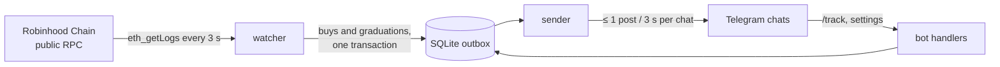

<p align="center">
  
</p>

<p align="center">
  <a href="https://t.me/SilverhandBuysBot"><b>Add @SilverhandBuysBot to your chat</b></a>
  ·
  <a href="#self-hosting">Self-host</a>
  ·
  <a href="#how-it-works">How it works</a>
</p>

<p align="center">
  <a href="https://github.com/Fiveloss/silverhand-buys/actions/workflows/tests.yml"></a>
  
  
  
  <a href="LICENSE"></a>
</p>

---

**Silverhand Buys** is a Telegram buy bot for token communities on
[Robinhood Chain](https://robinhood.com/us/en/chain/). A token's admins add it to
their group or channel, and it posts every buy of their token the moment it lands
on-chain: Pons and Flap.sh launches on their bonding curve and after graduation, and
any token with a Uniswap v2, v3 or v4 (or Ramses v3) pool.


- 💵 **Every buy, live**: amount paid, tokens received, the wallet (🆕 new holder or
  its position change), with dev buys and 🐋 whales marked; sells too if you want
- 🚨 **Dev sells, always**: when the token's creator sells, the post says DEV SELL and how
  much of their bag went, even in chats that turned sells off
- 🛡 **`/scan` any token**: the top 10 holders' share, snipers of the first seconds,
  what the dev sold, and a warning when an older token has the same ticker
- 🎞 **An animated card** with each post: the market-cap candles of the last hours,
  in the bot's style (or a still picture, or none)
- 📊 **Market cap and curve progress**, computed from the trade itself, and posts
  of their own when the market cap reaches a new round level or the curve fills
- 🎓 **Graduation announced**, then buys keep coming from the Uniswap v4 pool
- 📈 **Stats in the chat**: `/stats` for the day, `/top` for the biggest buyers, and
  a 📊 24h button under each post that answers only whoever taps it
- 🧹 **No spam**: at most one post per chat every 3 seconds; bursts are merged
- 🌐 **Your language**, per person and per chat; groups with topics work
- 🖼 **Your own GIF, photo or video** on every buy, if you want one
- 🔒 **Privacy mode on**: the bot only reads its own commands, never your chat
- 🚫 **No ads and no paid plans**: every chat gets everything, posts end with "NFA · DYOR"

Supports **Pons v2** and **Flap.sh** launches and **any token with a Uniswap v2, v3 or v4
pool** (Ramses v3 too): the bot finds its pools itself and follows the deepest ones. Dollar values for pairs
with ETH, WETH, USDG and 35 Robinhood stock tokens (NVDA, TSLA, SPY…, priced by their
Chainlink feeds on the chain).

<br clear="right">

## Add it to your chat

1. Open [@SilverhandBuysBot](https://t.me/SilverhandBuysBot) and tap **Add to a group**.
2. In the group, as an admin: `/track 0xYourTokenAddress`
3. `/test` shows a sample post with your settings. That's it.

**Groups with topics:** send `/track` inside the topic where the posts should go.

**Channels:** add the bot as an admin with permission to post. Then either send
the commands in the private chat with the bot (they apply to your current chat,
picked in `/chats`), or post them in the channel itself: the bot answers there
silently and removes the command and its answer a minute later. Every command
gets a confirmation.

**The private chat** is a menu with an animated screen per section. On the first
`/start` the bot asks for your language (`/lang` changes it). **My chats**
(`/chats`) lists every group and channel you added the bot to, with buttons for a
test post, stats, top buyers, sells, the chart and the posts' language.

| Command (admins only) | What it does |
|---|---|
| `/track 0x…` | post buys of this token (a Pons or Flap.sh launch, or any token with a Uniswap pool) |
| `/test` | preview a post with the current settings |
| `/minbuy 25` | skip buys under $25 |
| `/emoji 🚀` | the mark of a buy post (a sell is always 🔴) |
| `/whale 1000` | the 🐋 mark on buys from $1,000 (`0` turns it off) |
| `/sells on` · `/sells off` | post sells too (🔴 line), or only buys (the default) |
| `/chart on` · `still` · `off` | the market-cap candle chart with each post: animated (the default), a still picture, or none |
| `/stats` | the last 24 h: buys, sells, volume, market cap high and low, biggest buy, posts here |
| `/top` | the wallets that bought the most in the last 24 h |
| `/scan` · `/scan 0x…` | the chat's token (or any token): top 10 holders' share, snipers, what the dev sold, copy ticker. Anyone can also send it to the bot in private, and tap 🛡 Scan under a post |
| `/lang en` | the language of posts and answers in this chat |
| `/media` | reply to a GIF, photo or video to show it on every buy (`/media off` removes it) |
| `/settings` · `/untrack` · `/help` | settings, stop, help |

Commands from non-admins are ignored, so nobody can flood your chat through the bot.

## How it works



- **Pons launches.** On the curve, each Pons v2 bonding curve emits a
  `CurveBuy` event. After graduation, the token trades in a Uniswap v4 pool
  whose PoolId the bot derives locally from the token address (Pons hook,
  fee 0, tick spacing 200). The factory's graduation event switches between
  the two.
- **Flap.sh launches.** All Flap curves trade through one Portal, whose events name
  the token in their data: the bot reads the Portal's trades and keeps its tokens'.
  A curve's quote is ETH or a token (stock tokens too), as Flap's `getTokenV7` says.
  After graduation the token is followed in its Uniswap v2 pair.
- **Any other token.** `/track` finds the token's pools from their creation
  events over the whole chain (one filtered `eth_getLogs` each for v2, v3 and v4),
  keeps those against a quote it can value, reads their liquidity and follows up
  to six of the deepest, looking again every hour. Only pools from Uniswap's own
  factories (and Ramses v3) count: any contract can emit a fake `Swap`. A trade in
  a pool with another quote (USDG, NVDA…) is converted into the token's main quote,
  so the market cap and the chart stay in one unit.
- **The buyer, not the router.** The wallet is where the token stops: the pool's
  Transfer, followed through the bots and routers that pass it on in the same
  transaction.
- **Prices without extra calls.** A Pons curve is constant-product over a
  virtual reserve. With `k` read once, the price and the progress to graduation
  after a buy or a sell follow from the event alone. On Uniswap v3 and v4 the
  price comes from `sqrtPriceX96` in the swap event, on v2 from the pair's `Sync`
  right before the swap. Stock tokens are priced by their Chainlink feeds.
- **Gentle on the public RPC.** A handful of requests per 3-second tick, however
  many chats use the bot; only the few trades that get posted cost one or two
  more (the wallet's balance). There are backoffs on 429s, and log ranges are
  split when they get too big.
- **Dev sells without extra requests.** A sale by the token's creator is told by the
  creator's own Transfer in that transaction (a sale through a router or a trading
  bot counts too). Pool tokens' Transfers are read anyway; for Pons tokens on the
  curve one more query in the same batch asks only for Transfers their creators sent.
- **`/scan` reads the token's own history.** Its Transfer logs from the first mint,
  window by window under the RPC's 10,000-log cap, give balances, snipers and the
  dev's sales; the biggest holders' balances are read back from the chain in one
  batch. A scan is a one-off of about fifteen requests for a young token, kept for
  ten minutes and never part of the watcher's tick. Whether a token can be sold at
  all (a honeypot) is not checked: that needs a simulated sale, and the scan says so.
- **Nothing lost, nothing doubled.** A tick's posts and its last block are
  written in one transaction. After a long outage the bot skips ahead instead
  of flooding chats with stale buys.
- **Honest numbers.** A value the bot could not read is left out of the post,
  never shown as zero. Dollar values appear only for pairs it can price.

Every chain fact the bot relies on (addresses, event layouts, the curve model,
the PoolId derivation) is checked against real mainnet logs in
[`fixtures/`](fixtures/). [`tools/preflight.py`](tools/preflight.py) re-checks
them live before a server starts.

## Self-hosting

You need Python 3.10+, a bot token from [@BotFather](https://t.me/BotFather)
with **/setjoingroups** enabled, and a server that can reach
`rpc.mainnet.chain.robinhood.com` and `api.telegram.org`.

```bash
git clone https://github.com/Fiveloss/silverhand-buys.git buybot && cd buybot
bash deploy/install.sh        # creates .env and stops
nano .env                     # BOT_TOKEN, OWNER_IDS
bash deploy/install.sh        # tests → live preflight → systemd service
journalctl -u buybot -f
```

`install.sh` refuses to start the bot unless the offline tests and the live
preflight pass. The systemd unit caps the bot at 300 MB of RAM and 30% of a
CPU, so it can share a small server.

<details>
<summary><b>Configuration</b> (<code>.env</code>)</summary>

| Variable | Default | Meaning |
|---|---|---|
| `BOT_TOKEN` | — | from @BotFather |
| `OWNER_IDS` | — | Telegram ids that get outage notices and `/support` messages |
| `TRADE_URL` | GMGN token page | the Chart button; `{token}` is replaced, and it may carry your referral code |
| `SUPPORT_CONTACT` | — | shown by `/support` |
| `SOURCE_URL` | — | link to your source, shown in `/terms` (see License) |
| `RPC_URL` · `EXPLORER_URL` | public RPC · Blockscout | chain endpoints |
| `POLL_SECONDS` · `RPC_MIN_INTERVAL` | `3` · `0.3` | how often to poll, spacing between RPC calls |

Owner commands in the private chat: `/admin` (the control panel: chats and health),
`/botstats`, and `/emojipack` (uploads the custom emoji set from `assets/emoji`; run it
once, and again after `tools/make_emoji.py` redraws them).
</details>

## Development

```bash
python3 tests.py                  # standard library only, no network
pip install -r requirements.txt
python3 tests_bot.py              # the Telegram layer against a fake Bot API, no network
python3 tools/preflight.py        # live checks against Robinhood Chain
```

| Path | What lives there |
|---|---|
| `buybot/chain.py` | Pons v2 and Uniswap v4 facts, log decoders, PoolId, curve math |
| `buybot/pools.py` | any token's Uniswap v2/v3/v4 pools: finding, ranking, swap decoders |
| `buybot/quotes.py` | quotes with dollar values: ETH, USDG, stock tokens and their Chainlink feeds |
| `buybot/watcher.py` | new blocks → buys and graduations → outbox |
| `buybot/sender.py` | outbox → Telegram: rate limits, merging, error handling |
| `buybot/bot.py` | commands, the private-chat menu, owner tools |
| `buybot/render.py` | post text (pure functions) |
| `buybot/scan.py` | `/scan`: holders, snipers, the dev and the ticker, from Transfer logs |
| `buybot/db.py` · `rpc.py` · `prices.py` · `tokens.py` | storage, JSON-RPC, ETH/USD, token lookup |

The chain facts and house rules the code relies on are in [docs/CHAIN.md](docs/CHAIN.md).
See [CONTRIBUTING.md](CONTRIBUTING.md) before opening a pull request.

## Safety

The bot **never** asks for private keys or seed phrases and never trades. Anyone
who asks for them in its name is a scammer. To report a vulnerability, see
[SECURITY.md](SECURITY.md).

## Disclaimer

Silverhand Buys is not affiliated with Robinhood Markets, Inc. or Pons. Posts
show on-chain activity as it happens and are **not financial advice**.
Memecoins are extremely risky: do your own research.

## License

[AGPL-3.0](LICENSE). You can use, change and run this code. If you run a
modified copy as a service for others, you must offer them its source (set
`SOURCE_URL` so `/terms` links to it). The test fixtures include mainnet data
captured by the [realorrug](https://github.com/1xmint/realorrug) project
(Apache-2.0); see [`fixtures/README.md`](fixtures/README.md).
